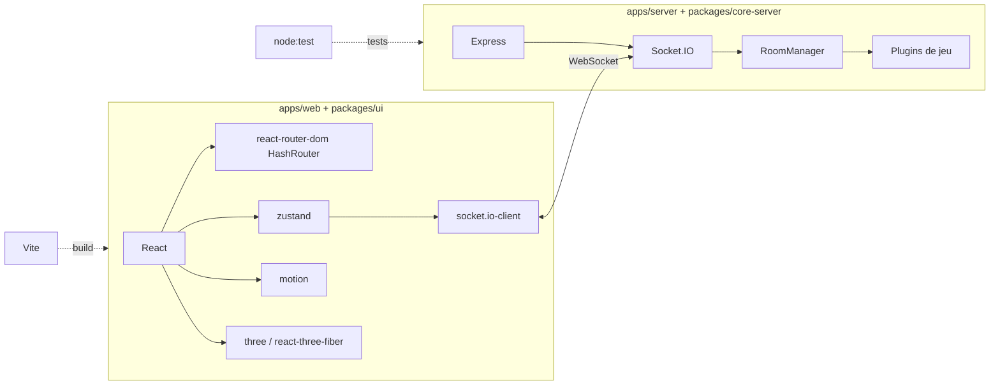
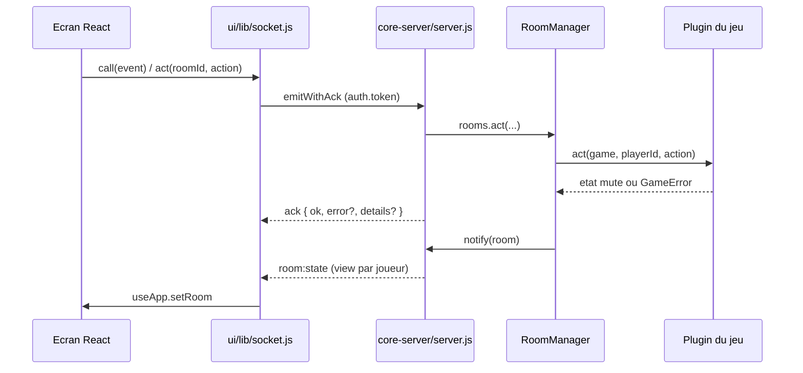
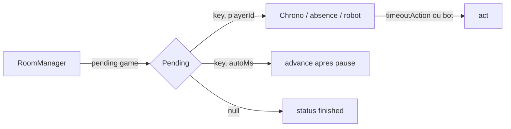
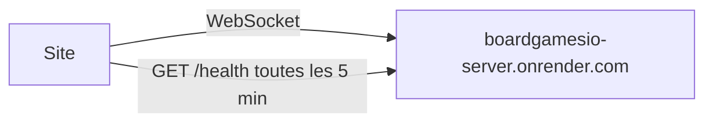
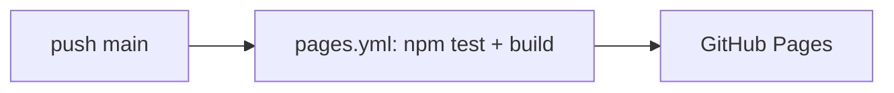

# Architecture

- [Language/Framework](#languageframework)
  - [Naming Conventions](#naming-conventions)
- [Services communication](#services-communication)
  - [Client ↔ serveur (Socket.IO)](#client--serveur-socketio)
  - [Socle ↔ plugin de jeu](#socle--plugin-de-jeu)
  - [External Services](#external-services)

## Language/Framework

```json
@package.json
@apps/web/package.json
@packages/core-server/package.json
```

- JavaScript pur, ES modules, Node ≥ 22, monorepo npm workspaces.
- Pas de TypeScript (JSDoc ponctuel), pas de linter.
- Pas de base de données : sessions et salons en mémoire (`Map`).



- Front : React, routage `HashRouter` (`/`, `/room/:code`, `/dev/*`), état global zustand (`useApp`, `usePrefs`), animations motion, héros 3D three chargé en `lazy`.
- Back : Express (`/health`, `/games`) + Socket.IO ; règles dans des plugins par jeu.
- Tests : `node:test` + `node:assert/strict`, `rng` déterministe injecté.

### Naming Conventions

- **Files**: composants `PascalCase.jsx`, modules `camelCase.js`, CSS `kebab/lowercase.css`, tests `*.test.js`
- **Components**: PascalCase (`Game`, `Results`, `LobbySettings`, `RulesSheet`, `Cover`)
- **Functions**: camelCase (`createPlatformServer`, `viewFor`)
- **Variables**: camelCase
- **Constants**: UPPER_CASE (`DEFAULT_TIMINGS`, `SERVER_URL`)
- **Classes**: PascalCase (`RoomManager`, `SessionStore`, `GameError`)
- **Événements socket**: `domaine:action` (`room:create`, `game:action`)
- **Codes d'erreur**: UPPER_SNAKE (`ROOM_NOT_FOUND`, `ROOM_IN_GAME`)
- **Packages**: `@bgio/<nom>`

## Services communication

### Client ↔ serveur (Socket.IO)



- Connexion : `io.use` résout la session depuis `handshake.auth.token`, push `session` (avec jeton) au client.
- Chaque joueur a son canal `player:<id>` ; `room:state` = `rooms.view(room, id)` personnalisé.
- Commandes, payloads, codes d'erreur, CORS : voir `internal/api-docs.md`.

### Socle ↔ plugin de jeu



- Contrat `GamePlugin` validé par `validatePlugin` (`packages/core-server/src/plugin.js`).
- `key` change à chaque décision → réarme le chrono.
- Robots : `bot(view, playerId, rng)` sur leur propre vue, délai 700–1400 ms.
- `view(game, viewerId)` ne révèle jamais d'information cachée.

### External Services

#### Render (serveur)



- URL de prod par défaut dans `packages/ui/src/lib/socket.js` (surcharge `VITE_SERVER_URL`).
- Offre gratuite qui s'endort : délai de connexion 75 s, ping keep-alive `/health` quand l'onglet est visible.

#### GitHub Pages (site)



- `apps/web/dist` publié avec `BASE_PATH=/<repo>/` ; `HashRouter` faute de fallback SPA.
