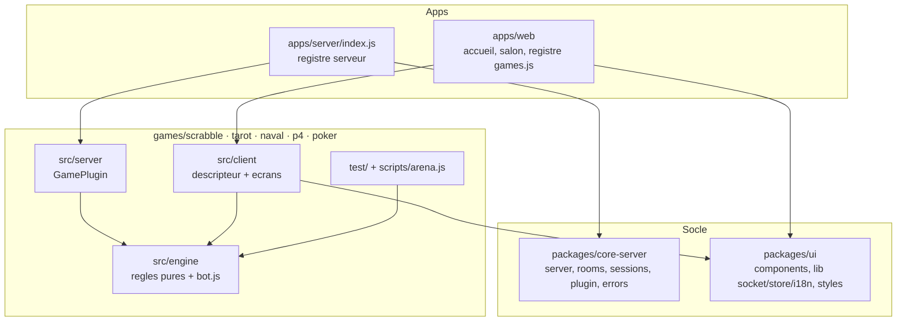

# Codebase Structure

- `apps/server/index.js` : `createPlatformServer({ games: [...] })`, `preload()`, écoute `PORT` ou 3001.
- `apps/web/src/games.js` : liste `GAMES` des descripteurs client ; `App.jsx` : routes ; `platform/home`, `platform/room` (`Lobby`, `RoomScreen`).
- `packages/core-server/src` : `server.js` (Express + Socket.IO), `rooms.js` (`RoomManager`), `sessions.js` (`SessionStore`), `plugin.js` (contrat), `errors.js` (`GameError`).
- `packages/ui/src` : `components/` (`ui.jsx`, `Toaster`, `NicknameSheet`, `SettingsSheet`…), `lib/` (`socket.js`, `store.js`, `i18n.js`, `prefs.js`, `feedback.js`), `styles/` (`tokens.css`, `base.css`).
- `games/<jeu>/package.json` : exports `./engine`, `./server`, `./client`, `./client/*`.
- `games/scrabble/assets/dictionaries` : dictionnaires FR/EN chargés côté serveur (`src/server/dictionary.js`).
- Pages de revue design non liées : `/#/dev/cartes` (tarot), `/#/dev/naval`, `/#/dev/p4`.
- `.github/workflows/pages.yml` : tests + build + déploiement GitHub Pages.
