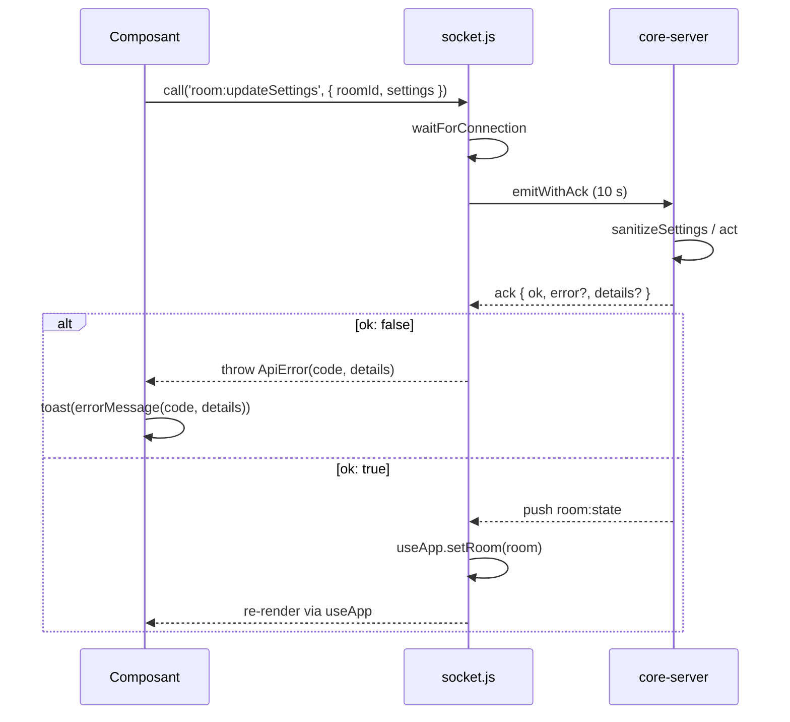

# Communication between backend and frontend

Tout passe par Socket.IO (`socket.io-client`), aucune API REST côté client hormis le ping `/health`.

## Overview

- **API definition**: pas d'OpenAPI ; liste des événements, payloads et codes d'erreur dans `internal/api-docs.md`.
- **Services**: `packages/ui/src/lib/socket.js` (`socket`, `connect`, `call`, `act`, `ApiError`, `SERVER_URL`) ; état global `packages/ui/src/lib/store.js` (`useApp` : `connection`, `session`, `room`, `clockOffset`, `serverNow()`).
- **Request Types**: toute commande via `call(event, payload)` → `emitWithAck` (timeout 10 s) ; `game:action` via `act(roomId, { type, ...payload })`.
- **Push serveur**: `session` → token sauvegardé + `setSession` ; `room:state` → `setRoom`, ignoré si l'id ne correspond pas au salon courant.
- **Entities**: pas de modèles client ; on consomme les vues serveur (`room`, `session`). Moteurs partagés importables depuis `@bgio/<jeu>/engine`.
- **Data Flow**: le client envoie une commande, l'accusé dit oui/non, l'état à jour arrive par `room:state` (source de vérité).
- **Error Handling**:
  - `ok: false` → `throw new ApiError(error || 'INTERNAL', details)`.
  - erreurs client : `OFFLINE` (pas de connexion après `connectTimeoutMs`, 75 s par défaut pour le réveil Render), `TIMEOUT`.
  - code → texte FR par `errorMessage(code, details)` ; messages socle dans `i18n.js`, chaque jeu ajoute les siens via `registerErrors` (`games/<jeu>/src/client/i18n.js`). Code inconnu → message `INTERNAL`.
  - affichage : toast `tone: 'error'`, ou écran « Oups » dans `RoomScreen`.
- **Validation**: côté serveur uniquement (moteur `GameError`, `sanitizeSettings`, `normalizeNickname`).

## Connexion et session

- `SERVER_URL` : `VITE_SERVER_URL`, sinon `http://<hôte>:3001` en dev, sinon le serveur Render.
- `autoConnect: false`, `connect()` appelé au chargement ; transports `websocket` puis `polling`.
- `auth` est une fonction : chaque reconnexion renvoie le dernier token (`bgio:token` en `localStorage`, mémoire seule en navigation privée).
- `connection` du store : `idle | connecting | online | offline` ; bannière « Connexion perdue » dans `RoomScreen`.
- Sur `connect`, `RoomScreen` relance `room:join` (le serveur a pu redémarrer). Quitter la page planifie `room:leave` après 150 ms (anti StrictMode) ; en partie, le siège est conservé.
- Keep-alive : `fetch(/health)` toutes les 5 min tant que l'onglet est visible.
- `clockOffset` = `room.serverNow - Date.now()` pour les chronos (`serverNow()`).

### Data Flow

