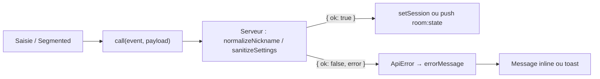

# Forms

Pas de bibliothèque de formulaires. Trois formulaires : pseudo (`packages/ui/src/components/NicknameSheet.jsx`), code de salon (`apps/web/src/platform/home/Home.jsx`), réglages de salon (`apps/web/src/platform/room/Lobby.jsx` + `games/<jeu>/src/client/LobbySettings.jsx`).

## State Management

- État local `useState` (valeur, erreur, `saving`/`busy`).
- Réglages de salon : pas d'état local ; chaque changement de `Segmented` envoie `room:updateSettings` immédiatement, la valeur affichée vient de `room.settings` (push `room:state`).
- `LobbySettings` d'un jeu reçoit `{ settings, disabled, update }` ; `disabled` = pas hôte. La plateforme ajoute `turnSeconds` et `maxPlayers`.
- Pseudo : après succès, `setSession` du store zustand mis à jour avec le pseudo normalisé renvoyé.

## Validation

- Côté client, minimale : pseudo `maxLength={16}` et bouton désactivé si vide ; code filtré par `extractCode` (5 caractères autorisés, accepte un lien collé) et bouton désactivé tant qu'incomplet.
- Validation réelle côté serveur :
  - pseudo : `normalizeNickname` (`packages/core-server/src/sessions.js`) → `INVALID_NICKNAME`.
  - réglages : `plugin.sanitizeSettings(base, patch, { memberCount })` de chaque jeu, valeurs en liste blanche → `GameError('INVALID_SETTINGS', { field })`.

## Error handling

- Pseudo : message inline sous le champ (`.field.is-invalid`, `.field-hint.is-error`, `aria-invalid`).
- Code / réglages : `toast({ tone: 'error' })` + son / vibration d'erreur sur l'accueil.
- Texte via `errorMessage(code, details)` (`packages/ui/src/lib/i18n.js`).

## Form Flow

