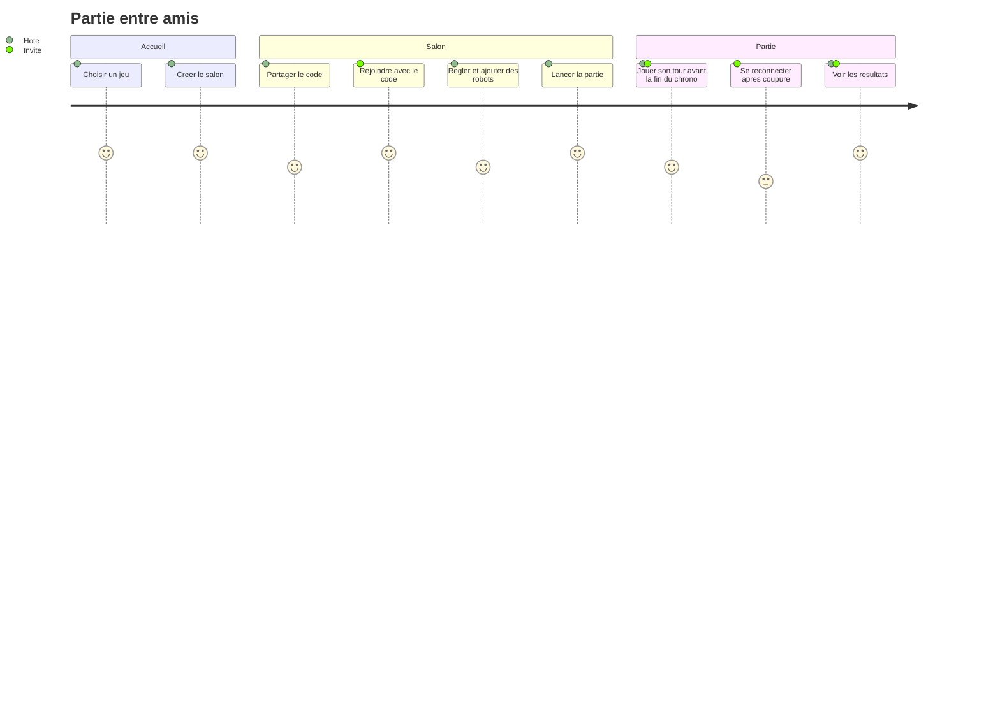

# PROJECT_BRIEF.md

BoardGamesIO : plateforme de jeux de société en ligne, un serveur et un site communs, un module par jeu.

## Executive Summary

- **Project Name**: BoardGamesIO
- **Vision**: Jouer à des jeux de société entre amis, dans le navigateur, sans compte.
- **Mission**: Un socle commun (salons, tours, chrono, robots, reconnexion) sur lequel chaque jeu ne fournit que ses règles et ses écrans.

### Full Description

- Site web mobile-friendly (testable sur téléphone via le réseau local).
- Identité anonyme : pseudo + jeton stocké dans le navigateur, pas d'inscription.
- Jeux disponibles : ScrabbleIO, TarotIO, NavalIO, P4IO, PokerIO.
- Interface en français.

## Context

### Core Domain

- Parties multijoueurs au tour par tour, en temps réel.
- Le socle gère le cycle de vie d'un salon : `lobby` → `playing` → `finished`.
- Chaque jeu définit ses règles, ce qu'attend la partie et ce que chaque joueur a le droit de voir.

### Ubiquitous Language

| Term | Definition | Synonymes |
| --- | --- | --- |
| Salon | Espace identifié par un code, où des joueurs se réunissent pour une partie | room |
| Hôte | Créateur du salon : règle les paramètres, ajoute des robots, lance, met en pause | host |
| Session | Identité d'un joueur (id public + jeton secret), survit au rechargement | — |
| Robot | Joueur automatique qui décide à partir de sa propre vue | bot |
| Vue | Ce qu'un joueur a le droit de voir de la partie, sans information cachée | `view` |
| Chrono | Temps imparti par tour/décision ; à expiration, une action par défaut est jouée | timer, `turnSeconds` |
| Absence | Joueur déconnecté : sa décision est jouée automatiquement après un délai | away |
| Manche | Sous-partie d'un jeu (P4IO, TarotIO, PokerIO) | round |

## Features & Use-cases

- Créer un salon pour un jeu, partager son code, rejoindre via le code ou un lien `/#/room/<code>`.
- Choisir son pseudo ; préférences thème, son, vibrations.
- Régler la partie dans le salon (nombre de joueurs, temps par tour, options du jeu).
- Ajouter/retirer des robots (sauf ScrabbleIO).
- Jouer avec chrono par tour, pause/reprise par l'hôte.
- Reconnexion transparente ; reprise d'une partie en cours depuis l'accueil.
- Consulter les règles (`RulesSheet`) et les résultats en fin de partie.

| Jeu | Joueurs | Robots | Auteur |
| --- | --- | --- | --- |
| ScrabbleIO (FR/EN) | 2 à 4 | non | Adrien |
| TarotIO | 3 à 5 | oui | Adrien |
| NavalIO (bataille navale, chacun pour soi) | 2 à 4 | oui | Adrien |
| P4IO (alignement de 4, plusieurs manches) | 2 à 3 | oui | Adrien |
| PokerIO (Texas Hold'em) | 2 à 6 | oui | Flo |

## User Journey maps

### Hôte

- Lance une partie pour son groupe.
- Choisit le jeu, règle le salon, ajoute des robots, démarre, met en pause.

#### Organiser une partie

- Accueil → choisit un jeu → salon créé → partage le code → règle → lance → joue → résultats.

### Invité

- Rejoint une partie sans compte.

#### Rejoindre une partie

- Reçoit un code/lien → rejoint le salon → choisit son pseudo → joue → peut quitter et revenir.
